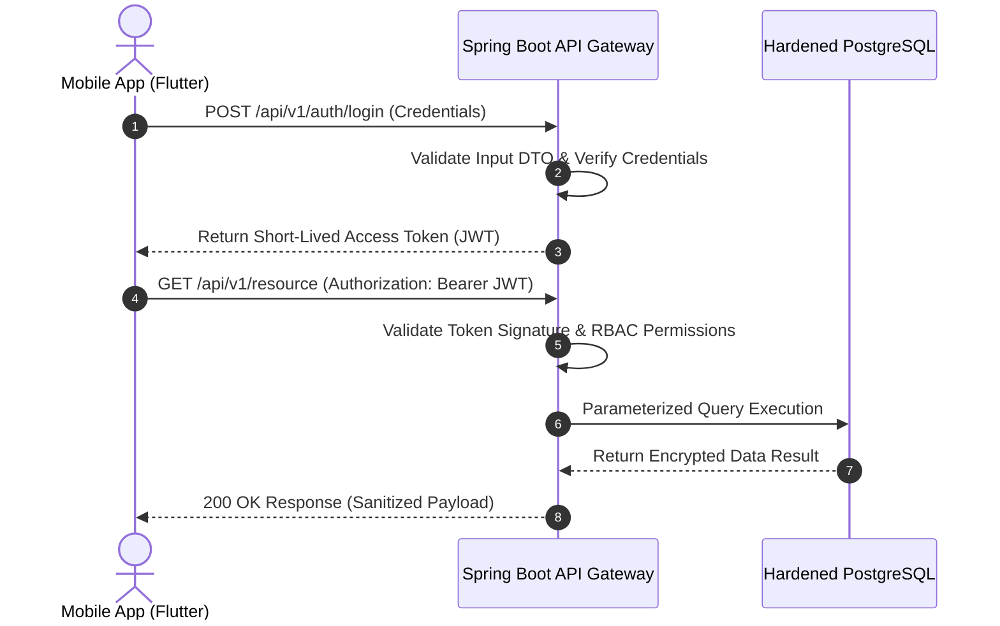
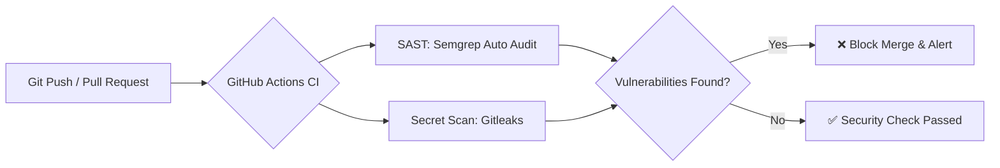

# Secure Full-Stack API Architecture Blueprint


A comprehensive architectural blueprint showcasing secure software development practices, robust authentication workflows, and server hardening guidelines based on international standards (**OWASP Top 10** & **OWASP API Security Top 10**).


---


## System Architecture Overview

```bash
[ Mobile App (Flutter) ] │  HTTPS / TLS 1.3

               ▼

[ API Gateway / Spring Boot Backend ] ── (Stateless JWT & Rate Limiting) │  Encrypted Internal Connection

               ▼ 

[ PostgreSQL Database (Hardened VPS) ]
```
## System Architecture and Authentication Flow



## 🔒 Security Best Practices Implemented


### 1. Authentication & Access Control 
*(Mitigation against OWASP API1:2023 - Broken Object Level Authorization)*
- **Stateless JWT Authentication:** Implemented short-lived access tokens combined with secure refresh token rotation to manage user sessions safely.
- **Strict Role-Based Access Control (RBAC):** Server-side validation verifying that the authenticated user owns or has permission to access the requested resource, preventing IDOR/BOLA vulnerabilities.


### 2. Input Validation & Data Handling 
*(Mitigation against OWASP A03:2021 - Injection)*
- **DTO Validation:** Enforced strict Data Transfer Object validation using Spring Boot validation annotations (`@NotNull`, `@Size`, `@Email`, etc.) at the controller entry point.
- **Parameterized Queries:** Utilized Hibernate ORM with PostgreSQL parameters to completely neutralize SQL Injection vectors.
- **Data Sanitization:** Stripped malicious payloads from user-generated inputs prior to database persistence or UI rendering to mitigate Cross-Site Scripting (XSS).


### 3. API Hardening & Resilience
- **Rate Limiting:** Configured IP-based request throttling on sensitive routes (such as login and password reset) to prevent automated Brute-Force attacks.
- **CORS Policy:** Defined strict Cross-Origin Resource Sharing restrictions, explicitly allowing only trusted frontend domains.
- **Centralized Error Handling:** Standardized error responses to ensure raw exception stack traces and internal server paths are never exposed to clients.


### 4. Infrastructure & Host Hardening (VPS)
- **Firewall Configuration (UFW):** Restricted all incoming traffic except essential ports (HTTP/80, HTTPS/443, and a custom SSH port).
- **SSH Hardening:** Disabled password-based SSH authentication entirely, enforcing secure SSH Key-Pair access.
- **Privilege Separation:** Configured application services to run under a dedicated non-root system user account.


## Remediation & Compliance Reference
This repository serves as a reference implementation model for designing secure backend APIs and developing effective remediation guidelines for enterprise penetration testing reports.


---
## Automated DevSecOps Pipeline


This repository enforces automated security checks on every push and pull_request using **GitHub Actions**:




**SAST (Semgrep):** Scans source code for OWASP Top 10 anti-patterns, injection vectors, and insecure configurations.
**Secret Scanning (Gitleaks):** Audits git commit history to prevent accidental exposure of API keys, tokens, and credentials.
