```mermaid

flowchart TB

%% =====================================================
%% 1. CLIENT / USER ACCESS LAYER
%% =====================================================

subgraph CLIENT["01 - CLIENT AND USER ACCESS LAYER"]
    U1["Desktop Browser"]
    U2["Mobile Browser"]
    U3["Mobile Application"]
    U4["Third Party API Client"]
    U5["IoT / Embedded Client"]

    U1 --> USER
    U2 --> USER
    U3 --> USER
    U4 --> USER
    U5 --> USER
    USER["End Users / External Consumers"]
end

%% =====================================================
%% 2. INTERNET AND DNS
%% =====================================================

subgraph INTERNET["02 - INTERNET AND NAME RESOLUTION"]
    DNS["Authoritative DNS"]
    DNSSEC["DNSSEC Validation"]
    GEO["GeoDNS / Global Traffic Steering"]
    INTERNET_GW["Internet / ISP / Global Network"]
end

USER --> INTERNET_GW
INTERNET_GW --> DNS
DNS --> DNSSEC
DNSSEC --> GEO

%% =====================================================
%% 3. GLOBAL EDGE INFRASTRUCTURE
%% =====================================================

subgraph EDGE["03 - GLOBAL EDGE NETWORK"]
    CDN["Global CDN / Edge PoPs"]
    CACHE_EDGE["Edge Cache"]
    EDGE_TLS["Edge TLS Termination"]
    DDOS["L3 / L4 / L7 DDoS Protection"]
    WAF["Web Application Firewall"]
    BOT["Bot Management / Anti Automation"]
    RATE["Rate Limiting / IP Reputation"]
    GEO_BLOCK["Geo Blocking / Access Policies"]
    EDGE_ROUTER["Edge Routing / Origin Selection"]
    ORIGIN_SHIELD["CDN Origin Shield"]

    CDN --> CACHE_EDGE
    CDN --> EDGE_TLS
    EDGE_TLS --> DDOS
    DDOS --> WAF
    WAF --> BOT
    BOT --> RATE
    RATE --> GEO_BLOCK
    GEO_BLOCK --> EDGE_ROUTER
    EDGE_ROUTER --> ORIGIN_SHIELD
end

GEO --> CDN

%% Cache hit and cache miss
CACHE_EDGE -->|Cache HIT| USER
ORIGIN_SHIELD -->|Cache MISS| INTERNET_ORIGIN

%% =====================================================
%% 4. PUBLIC ORIGIN AND PERIMETER
%% =====================================================

subgraph PERIMETER["04 - ORIGIN PERIMETER AND NETWORK SECURITY"]
    INTERNET_ORIGIN["Origin Endpoint"]
    ORIGIN_FIREWALL["Cloud Firewall / Security Groups"]
    PRIVATE_ORIGIN["Private Origin Connectivity"]
    NETWORK_ACL["Network ACL / Subnet Rules"]
    EXT_LB["External Load Balancer - L7"]
    INT_LB["Internal Load Balancer - L4 / L7"]
    REVERSE_PROXY["Reverse Proxy Cluster"]
    INGRESS["Kubernetes Gateway API / Ingress Gateway"]

    INTERNET_ORIGIN --> ORIGIN_FIREWALL
    ORIGIN_FIREWALL --> NETWORK_ACL
    NETWORK_ACL --> PRIVATE_ORIGIN
    PRIVATE_ORIGIN --> EXT_LB
    EXT_LB --> INT_LB
    INT_LB --> REVERSE_PROXY
    REVERSE_PROXY --> INGRESS
end

ORIGIN_SHIELD --> INTERNET_ORIGIN

%% =====================================================
%% 5. CLOUD NETWORK / VPC
%% =====================================================

subgraph CLOUD["05 - CLOUD NETWORK AND PRIVATE INFRASTRUCTURE"]
    VPC["Virtual Private Cloud / VNet"]

    subgraph PUBLIC_SUBNET["Public Subnet"]
        NAT_INGRESS["Ingress Network Interface"]
        BASTION["Bastion Host / Secure Administration"]
    end

    subgraph PRIVATE_APP["Private Application Subnet"]
        APP_NETWORK["Application Network"]
        SERVICE_DISCOVERY["Internal DNS / Service Discovery"]
        MESH["Service Mesh Control and Data Plane"]
        MTLS["Mutual TLS / Workload Identity"]
    end

    subgraph PRIVATE_DATA["Isolated Database Subnet"]
        DB_NETWORK["Private Data Network"]
        DB_FIREWALL["Database Firewall / Access Policies"]
    end

    VPC --> PUBLIC_SUBNET
    VPC --> PRIVATE_APP
    VPC --> PRIVATE_DATA
    APP_NETWORK --> SERVICE_DISCOVERY
    APP_NETWORK --> MESH
    MESH --> MTLS
    DB_NETWORK --> DB_FIREWALL
end

INGRESS --> VPC
INT_LB --> APP_NETWORK

%% =====================================================
%% 6. APPLICATION DELIVERY
%% =====================================================

subgraph APPLICATION["06 - APPLICATION DELIVERY LAYER"]
    API_GW["API Gateway"]
    AUTH_GATEWAY["Authentication Gateway"]
    API_ROUTER["API Routing / Versioning"]
    SSR["SSR / Frontend Rendering Server"]
    STATIC_ORIGIN["Static Frontend Origin"]
    FRONTEND["Frontend Application"]
    BFF["Backend For Frontend"]
    GRAPHQL["GraphQL / REST / gRPC API"]

    API_GW --> AUTH_GATEWAY
    AUTH_GATEWAY --> API_ROUTER
    API_ROUTER --> BFF
    API_ROUTER --> GRAPHQL
    SSR --> FRONTEND
    STATIC_ORIGIN --> FRONTEND
end

INGRESS --> API_GW
INGRESS --> SSR
INGRESS --> STATIC_ORIGIN

%% =====================================================
%% 7. FRONTEND RUNTIME
%% =====================================================

subgraph FRONTEND_RUNTIME["07 - FRONTEND RUNTIME"]
    HTML["HTML Document"]
    CSS["CSS / Design Assets"]
    JS["JavaScript / TypeScript Bundles"]
    SPA["SPA / React / Vue / Angular"]
    HYDRATION["Hydration / Client Runtime"]
    BROWSER_STORAGE["Browser Storage / IndexedDB"]
    SERVICE_WORKER["Service Worker / PWA"]

    HTML --> SPA
    CSS --> SPA
    JS --> SPA
    SPA --> HYDRATION
    HYDRATION --> BROWSER_STORAGE
    HYDRATION --> SERVICE_WORKER
end

FRONTEND --> HTML

%% Browser makes API calls
SPA -->|HTTPS / JSON / GraphQL| CDN

%% =====================================================
%% 8. KUBERNETES / CONTAINER PLATFORM
%% =====================================================

subgraph PLATFORM["08 - CONTAINER ORCHESTRATION PLATFORM"]
    K8S["Kubernetes Cluster"]

    subgraph CONTROL_PLANE["Kubernetes Control Plane"]
        API_SERVER["Kubernetes API Server"]
        SCHEDULER["Scheduler"]
        CONTROLLER["Controller Manager"]
        ETCD["etcd Cluster"]
    end

    subgraph WORKER_NODES["Worker Node Pool"]
        NODE1["Worker Node A"]
        NODE2["Worker Node B"]
        NODE3["Worker Node C"]

        PODS["Application Pods"]
        K8S_SERVICE["Kubernetes Services"]
        ENDPOINTS["EndpointSlices"]
        AUTOSCALER["HPA / Cluster Autoscaler"]
    end

    K8S --> CONTROL_PLANE
    CONTROL_PLANE --> WORKER_NODES
    K8S_SERVICE --> ENDPOINTS
    ENDPOINTS --> PODS
    AUTOSCALER --> WORKER_NODES
end

API_GW --> K8S_SERVICE
BFF --> PODS

%% =====================================================
%% 9. MICROSERVICES / BACKEND
%% =====================================================

subgraph BACKEND["09 - BACKEND AND MICROSERVICES"]
    AUTH["Authentication Service"]
    USER_SERVICE["User Management Service"]
    PROFILE["Profile Service"]
    SESSION["Session Management Service"]
    PRODUCT["Product / Catalog Service"]
    ORDER["Order Service"]
    PAYMENT["Payment Service"]
    INVENTORY["Inventory Service"]
    NOTIFICATION["Notification Service"]
    SEARCH["Search Service"]
    FILE_SERVICE["File / Media Service"]
    REPORTING["Reporting Service"]
    ADMIN["Admin / Management Service"]

    PODS --> AUTH
    PODS --> USER_SERVICE
    PODS --> PROFILE
    PODS --> SESSION
    PODS --> PRODUCT
    PODS --> ORDER
    PODS --> PAYMENT
    PODS --> INVENTORY
    PODS --> NOTIFICATION
    PODS --> SEARCH
    PODS --> FILE_SERVICE
    PODS --> REPORTING
    PODS --> ADMIN
end

%% =====================================================
%% 10. INTERNAL SERVICE COMMUNICATION
%% =====================================================

subgraph COMMUNICATION["10 - SERVICE-TO-SERVICE COMMUNICATION"]
    SERVICE_MESH["Service Mesh Proxy"]
    INTERNAL_MTLS["mTLS Encryption"]
    AUTHZ["Service Authorization / RBAC"]
    CIRCUIT["Circuit Breaker / Retry / Timeout"]
    TELEMETRY["Distributed Tracing"]
    EVENT_BUS["Event Bus / Message Broker"]

    SERVICE_MESH --> INTERNAL_MTLS
    INTERNAL_MTLS --> AUTHZ
    AUTHZ --> CIRCUIT
    CIRCUIT --> TELEMETRY
end

BACKEND --> SERVICE_MESH
SERVICE_MESH --> EVENT_BUS

%% =====================================================
%% 11. CACHING LAYER
%% =====================================================

subgraph CACHING["11 - DISTRIBUTED CACHING"]
    REDIS["Redis Cluster"]
    MEMCACHED["Memcached"]
    SESSION_CACHE["Session Cache"]
    OBJECT_CACHE["Object / Query Cache"]
    APP_CACHE["Application Cache"]

    REDIS --> SESSION_CACHE
    REDIS --> OBJECT_CACHE
    MEMCACHED --> APP_CACHE
end

AUTH --> REDIS
SESSION --> SESSION_CACHE
PRODUCT --> APP_CACHE
SEARCH --> REDIS

%% =====================================================
%% 12. DATA PERSISTENCE
%% =====================================================

subgraph DATABASE["12 - DATA STORAGE AND DATABASE"]
    DB_PROXY["Database Proxy / Connection Pooler"]
    PRIMARY_DB["Primary Relational Database"]
    REPLICA1["Read Replica A"]
    REPLICA2["Read Replica B"]
    NOSQL["NoSQL Database"]
    WAREHOUSE["Data Warehouse / OLAP"]
    SEARCH_ENGINE["Search Index / Search Engine"]
    OBJECT_STORAGE["Object Storage / Blob Storage"]
    BACKUP["Encrypted Backup Storage"]

    DB_PROXY --> PRIMARY_DB
    PRIMARY_DB --> REPLICA1
    PRIMARY_DB --> REPLICA2
    PRIMARY_DB --> BACKUP
end

AUTH --> DB_PROXY
USER_SERVICE --> DB_PROXY
PROFILE --> DB_PROXY
ORDER --> DB_PROXY
PAYMENT --> DB_PROXY
INVENTORY --> DB_PROXY

PRODUCT --> NOSQL
SEARCH --> SEARCH_ENGINE
REPORTING --> WAREHOUSE
FILE_SERVICE --> OBJECT_STORAGE

%% =====================================================
%% 13. ASYNCHRONOUS PROCESSING
%% =====================================================

subgraph ASYNC["13 - EVENT-DRIVEN AND BACKGROUND PROCESSING"]
    BROKER["Message Broker / Kafka / RabbitMQ"]
    QUEUE["Task Queue"]
    WORKER["Background Worker Pool"]
    SCHEDULER_JOB["Scheduled Jobs / Cron"]
    DLQ["Dead Letter Queue"]
    EVENT_STORE["Event Store"]

    BROKER --> QUEUE
    QUEUE --> WORKER
    QUEUE --> DLQ
    BROKER --> EVENT_STORE
    SCHEDULER_JOB --> WORKER
end

EVENT_BUS --> BROKER
WORKER --> NOTIFICATION
WORKER --> REPORTING
WORKER --> SEARCH

%% =====================================================
%% 14. IDENTITY AND SECURITY
%% =====================================================

subgraph SECURITY["14 - IDENTITY, SECRETS AND SECURITY GOVERNANCE"]
    IAM["IAM / Identity and Access Management"]
    IDP["Identity Provider / OIDC / OAuth 2.0"]
    MFA["MFA / Passkeys"]
    RBAC["RBAC / ABAC"]
    VAULT["Secrets Manager / Vault"]
    KMS["KMS / HSM / Key Management"]
    CERT["Certificate Management / PKI"]
    CSP["Content Security Policy"]
    AUDIT["Security Audit Logs"]
    SAST["SAST / DAST / SCA"]
    SUPPLY["Software Supply Chain Security"]

    IDP --> MFA
    IDP --> IAM
    IAM --> RBAC
    VAULT --> KMS
    CERT --> KMS
end

AUTH --> IDP
API_GW --> IAM
PLATFORM --> VAULT
DATABASE --> KMS

%% =====================================================
%% 15. OBSERVABILITY AND MONITORING
%% =====================================================

subgraph OBSERVABILITY["15 - OBSERVABILITY AND SECURITY MONITORING"]
    LOGS["Centralized Logging"]
    METRICS["Metrics Collection"]
    TRACES["Distributed Tracing"]
    APM["Application Performance Monitoring"]
    SIEM["SIEM / Security Analytics"]
    SOC["SOC / Security Operations"]
    ALERT["Alert Management"]
    DASHBOARD["Monitoring Dashboards"]

    LOGS --> SIEM
    METRICS --> APM
    TRACES --> APM
    SIEM --> SOC
    APM --> ALERT
    SOC --> ALERT
    ALERT --> DASHBOARD
end

BACKEND --> LOGS
EDGE --> LOGS
PLATFORM --> METRICS
COMMUNICATION --> TRACES
SECURITY --> SIEM

%% =====================================================
%% 16. EXTERNAL SERVICES AND EGRESS
%% =====================================================

subgraph EGRESS["16 - OUTBOUND NETWORK AND THIRD PARTY INTEGRATIONS"]
    NAT["NAT Gateway / Egress Gateway"]
    EGRESS_FW["Outbound Firewall / Egress Policies"]
    PAYMENT_EXT["External Payment Provider"]
    EMAIL_EXT["Email / SMS Provider"]
    OAUTH_EXT["External Identity Provider"]
    THIRD_PARTY["External APIs / SaaS"]
    DNS_OUT["Controlled DNS Resolver"]

    NAT --> EGRESS_FW
    EGRESS_FW --> PAYMENT_EXT
    EGRESS_FW --> EMAIL_EXT
    EGRESS_FW --> OAUTH_EXT
    EGRESS_FW --> THIRD_PARTY
    EGRESS_FW --> DNS_OUT
end

PAYMENT --> NAT
NOTIFICATION --> NAT
BACKEND --> NAT

%% =====================================================
%% 17. CI/CD AND INFRASTRUCTURE MANAGEMENT
%% =====================================================

subgraph DEVOPS["17 - DEVSECOPS AND INFRASTRUCTURE MANAGEMENT"]
    GIT["Git Repository"]
    CI["CI Pipeline"]
    TEST["Automated Testing"]
    SECURITY_SCAN["Security Scanning"]
    REGISTRY["Container Registry"]
    CD["CD / Deployment Pipeline"]
    GITOPS["GitOps Controller"]
    IAC["Infrastructure as Code"]
    TERRAFORM["Terraform / OpenTofu"]
    CONFIG["Configuration Management"]

    GIT --> CI
    CI --> TEST
    TEST --> SECURITY_SCAN
    SECURITY_SCAN --> REGISTRY
    REGISTRY --> CD
    CD --> GITOPS
    IAC --> TERRAFORM
    TERRAFORM --> CONFIG
end

GITOPS --> K8S
CONFIG --> VPC
SECURITY_SCAN --> SUPPLY

%% =====================================================
%% 18. HIGH AVAILABILITY AND DISASTER RECOVERY
%% =====================================================

subgraph RESILIENCE["18 - HIGH AVAILABILITY AND DISASTER RECOVERY"]
    AZ1["Availability Zone A"]
    AZ2["Availability Zone B"]
    AZ3["Availability Zone C"]
    REGION1["Primary Region"]
    REGION2["Secondary Region"]
    FAILOVER["Global Failover / Health Checks"]
    DR["Disaster Recovery"]
    REPLICATION["Cross-Region Data Replication"]

    REGION1 --> AZ1
    REGION1 --> AZ2
    REGION1 --> AZ3
    REGION1 --> REPLICATION
    REPLICATION --> REGION2
    FAILOVER --> REGION2
    REGION2 --> DR
end

PLATFORM --> AZ1
PLATFORM --> AZ2
PLATFORM --> AZ3
DATABASE --> REPLICATION
```

# Modern Enterprise Web Application Network Architecture

## 1. Overview

The Modern Enterprise Web Application Network Architecture represents a comprehensive, scalable, secure, and highly available infrastructure designed to support modern web applications and distributed services.

This architecture illustrates the complete communication flow between end users, the public internet, global edge infrastructure, network security layers, application delivery components, backend services, databases, cloud infrastructure, and external integrations.

It combines modern networking principles, cloud-native technologies, microservices architecture, container orchestration, distributed data storage, DevSecOps practices, and Zero Trust security principles.

The primary objective is to ensure that every component operates within a clearly defined responsibility while maintaining security, performance, scalability, reliability, and operational visibility.

## 2. Client and User Access Layer

The Client and User Access Layer represents the entry point of the entire application ecosystem.

It consists of desktop browsers, mobile browsers, mobile applications, third-party API clients, and IoT or embedded devices.

Users interact with the application through HTTP or HTTPS requests, typically using encrypted TLS connections.

This layer is responsible for initiating communication with the application infrastructure and consuming resources delivered by the frontend and backend systems.

## 3. Internet and DNS Infrastructure

The Internet and DNS Infrastructure provides global connectivity and domain name resolution.

Its primary components include:

- Authoritative DNS
- DNSSEC
- GeoDNS
- Global Traffic Steering
- Internet Service Providers (ISPs)
- Public Internet Connectivity

DNS translates domain names into the appropriate network destinations, while DNSSEC provides cryptographic authentication of DNS data.

GeoDNS and global traffic steering can direct users toward geographically appropriate infrastructure based on configured routing policies, availability, and performance considerations.

## 4. Global Edge Network

The Global Edge Network is the first major infrastructure layer responsible for optimizing and protecting incoming application traffic.

It typically consists of:

- Content Delivery Network (CDN)
- Edge Caching
- TLS Termination
- Distributed Denial-of-Service (DDoS) Protection
- Web Application Firewall (WAF)
- Bot Management
- Rate Limiting
- IP Reputation Filtering
- Geographic Access Policies
- Origin Shield

The CDN distributes static and cacheable content through geographically distributed Points of Presence (PoPs).

The WAF inspects incoming HTTP requests to identify and mitigate common web application attacks, including SQL injection, cross-site scripting, and other malicious request patterns.

DDoS protection helps mitigate attacks targeting network, transport, and application layers.

When a requested resource is available in the edge cache, the CDN can deliver it directly without contacting the origin infrastructure.

When a cache miss occurs, the request is forwarded toward the origin according to the configured routing and security policies.

## 5. Origin Perimeter and Network Security

The Origin Perimeter Layer protects the infrastructure hosting the actual application services.

It includes:

- Origin Endpoints
- Cloud Firewalls
- Security Groups
- Network Access Control Lists (ACLs)
- Private Origin Connectivity
- External Load Balancers
- Internal Load Balancers
- Reverse Proxy Clusters
- Kubernetes Gateway API or Ingress Gateway

This layer establishes controlled access between the public edge network and private application infrastructure.

Firewalls and network policies restrict unauthorized connectivity, while load balancers distribute incoming traffic across available application instances.

Reverse proxies provide request forwarding, routing, connection management, and other application delivery capabilities.

The origin should ideally accept traffic only through trusted and explicitly authorized paths rather than being directly accessible from arbitrary internet clients.

## 6. Cloud Network and Private Infrastructure

The Cloud Network Layer provides logical network isolation and controlled communication between infrastructure components.

It consists of:

- Virtual Private Cloud (VPC) or Virtual Network (VNet)
- Public Subnets
- Private Application Subnets
- Isolated Database Subnets
- Internal DNS
- Service Discovery
- Service Mesh
- Mutual TLS (mTLS)
- Bastion Hosts

Public-facing infrastructure is separated from internal application workloads and database resources.

Private subnets reduce direct internet exposure, while network segmentation limits unnecessary communication between infrastructure components.

Service discovery enables services to locate other services dynamically, and service mesh technologies provide infrastructure-level communication management, workload identity, and encrypted service-to-service communication.

## 7. Application Delivery Layer

The Application Delivery Layer manages the delivery and routing of frontend and backend application requests.

Its major components include:

- API Gateway
- Authentication Gateway
- API Routing and Versioning
- Server-Side Rendering (SSR)
- Static Frontend Origin
- Backend for Frontend (BFF)
- REST APIs
- GraphQL APIs
- gRPC Services

The API Gateway acts as a centralized entry point for API traffic.

It can enforce authentication, authorization policies, rate limiting, request routing, and API version management.

Server-Side Rendering generates application content on the server before delivering it to the client.

The Backend for Frontend pattern provides an application-specific backend interface optimized for different frontend clients.

## 8. Frontend Runtime

The Frontend Runtime Layer represents the client-side execution environment of the web application.

It includes:

- HTML Documents
- CSS Assets
- JavaScript and TypeScript Bundles
- Single Page Applications (SPA)
- React, Vue, or Angular Applications
- Client-Side Hydration
- Browser Storage
- IndexedDB
- Service Workers
- Progressive Web Application (PWA) Capabilities

This layer is responsible for rendering user interfaces, managing client-side interactions, maintaining application state, and communicating with backend APIs.

Frontend applications typically communicate with backend services through secure HTTPS connections.

Client-side storage can improve application performance, but sensitive authorization decisions must always be enforced on the server side.

## 9. Container Orchestration Platform

The Container Orchestration Layer manages the deployment, scheduling, scaling, and lifecycle of containerized workloads.

Kubernetes is an example of a platform used to implement this architecture.

Its components include:

- Kubernetes Control Plane
- API Server
- Scheduler
- Controller Manager
- etcd
- Worker Nodes
- Application Pods
- Kubernetes Services
- EndpointSlices
- Horizontal Pod Autoscaler (HPA)
- Cluster Autoscaler

The control plane maintains the desired state of the cluster, while worker nodes execute application workloads.

Kubernetes Services provide stable network access to dynamically changing application instances.

Autoscaling mechanisms adjust application replicas and infrastructure capacity according to resource utilization and configured scaling policies.

## 10. Backend and Microservices Architecture

The Backend Layer contains the application's business logic and core processing services.

It can be implemented using a microservices architecture in which application capabilities are separated into independently deployable services.

Typical services include:

- Authentication Service
- User Management Service
- Profile Service
- Session Management Service
- Product and Catalog Service
- Order Management Service
- Payment Service
- Inventory Service
- Notification Service
- Search Service
- File and Media Service
- Reporting Service
- Administrative Service

Each service is responsible for a specific business domain and communicates with other services through well-defined interfaces.

This approach improves modularity, maintainability, independent deployment, and horizontal scalability.

## 11. Service-to-Service Communication

The Service Communication Layer manages internal communication between distributed application components.

Its capabilities include:

- Service Mesh
- Mutual TLS
- Workload Identity
- Service Authorization
- Role-Based Access Control
- Circuit Breakers
- Retry Policies
- Request Timeouts
- Distributed Tracing

Mutual TLS provides encryption and identity verification between supported service endpoints.

Circuit breakers and timeout policies help prevent cascading failures when downstream services become unavailable or experience performance degradation.

## 12. Distributed Caching Layer

The Distributed Caching Layer reduces unnecessary database operations and improves application response times.

Common technologies include Redis and Memcached.

Typical caching use cases include:

- Session Storage
- Authentication State
- Frequently Accessed Objects
- Query Results
- Application Data
- Temporary Computation Results

Caching strategies must account for expiration, invalidation, consistency, and security requirements.

## 13. Database and Data Persistence Layer

The Database Layer provides persistent storage for application data.

It may include multiple database technologies depending on the application's requirements.

Typical components include:

- Database Proxy
- Connection Pooling
- Primary Relational Database
- Read Replicas
- NoSQL Database
- Data Warehouse
- Search Engine
- Object Storage
- Encrypted Backup Storage

Relational databases handle structured transactional data, while NoSQL databases support flexible data models and specialized access patterns.

Read replicas can distribute read workloads, while object storage provides scalable storage for files, documents, and media.

Database access should be restricted to authorized application services through private networking, authentication, and database-level permissions.

## 14. Event-Driven and Background Processing

The Event-Driven Architecture Layer enables asynchronous communication and background execution.

It typically uses message brokers, event streaming platforms, and task queues.

Common components include:

- Apache Kafka
- RabbitMQ
- Message Queues
- Background Workers
- Scheduled Jobs
- Dead Letter Queues (DLQ)
- Event Stores

This architecture allows services to publish and consume events without requiring synchronous communication for every operation.

It is particularly useful for notifications, payment processing workflows, reporting, data synchronization, and other background operations.

## 15. Identity and Security Governance

The Identity and Security Layer provides centralized security controls across the application ecosystem.

It includes:

- Identity and Access Management (IAM)
- Identity Providers (IdP)
- OAuth 2.0
- OpenID Connect (OIDC)
- Multi-Factor Authentication (MFA)
- Passkeys
- RBAC and ABAC
- Secrets Management
- Key Management Services (KMS)
- Hardware Security Modules (HSM)
- Public Key Infrastructure (PKI)
- Certificate Management
- Content Security Policy (CSP)
- Security Audit Logging
- Software Supply Chain Security

This layer establishes identity verification, access control, credential management, cryptographic protection, and security governance.

The architecture follows Zero Trust principles by avoiding implicit trust based solely on network location.

Every access request should be evaluated according to identity, authorization, context, and applicable security policies.

## 16. Observability and Security Monitoring

The Observability Layer provides operational visibility into the entire infrastructure.

It consists of:

- Centralized Logging
- Metrics Collection
- Distributed Tracing
- Application Performance Monitoring (APM)
- Security Information and Event Management (SIEM)
- Security Operations Center (SOC)
- Alert Management
- Monitoring Dashboards

Logs provide event records, metrics measure system behavior, and distributed traces help identify request execution paths across multiple services.

SIEM platforms correlate security events and support threat detection, investigation, and incident response.

Together, these capabilities enable infrastructure operators and security teams to identify performance bottlenecks, application failures, suspicious activities, and potential security incidents.

## 17. Outbound Network and Third-Party Integrations

The Outbound Network Layer controls communication initiated by internal services toward external systems.

It includes:

- NAT Gateway
- Egress Gateway
- Outbound Firewalls
- External Payment Providers
- Email and SMS Services
- External Identity Providers
- Third-Party APIs
- Controlled DNS Resolvers

Outbound traffic should follow explicitly defined network policies.

This reduces unnecessary external exposure and helps mitigate risks associated with unauthorized communication and Server-Side Request Forgery (SSRF).

## 18. DevSecOps and Infrastructure Management

The DevSecOps Layer manages the application development and deployment lifecycle.

Its components include:

- Git Repositories
- Continuous Integration (CI)
- Automated Testing
- SAST
- DAST
- Software Composition Analysis (SCA)
- Container Registries
- Continuous Deployment (CD)
- GitOps Controllers
- Infrastructure as Code (IaC)
- Terraform or OpenTofu
- Configuration Management

Security testing is integrated into the software delivery pipeline to identify vulnerabilities before deployment.

Infrastructure as Code enables infrastructure provisioning through version-controlled and repeatable configurations.

GitOps provides a declarative approach to managing application and infrastructure deployments.

## 19. High Availability and Disaster Recovery

The High Availability and Disaster Recovery Layer ensures infrastructure resilience against hardware failures, application disruptions, and regional outages.

It incorporates:

- Multiple Availability Zones
- Multi-Region Deployment
- Global Health Checks
- Traffic Failover
- Cross-Region Data Replication
- Backup and Recovery
- Disaster Recovery Procedures

Applications can be distributed across multiple availability zones to reduce the impact of individual infrastructure failures.

Cross-region replication and disaster recovery strategies provide additional resilience against larger infrastructure disruptions.

Recovery Time Objective (RTO) and Recovery Point Objective (RPO) should be defined according to business continuity requirements.

## 20. End-to-End Request Processing Flow

A typical web application request follows this logical sequence:

1. A user accesses the application through a browser or mobile application.
2. DNS resolves the requested domain name.
3. Traffic is routed through the global edge network.
4. CDN caching, DDoS protection, and WAF policies process incoming traffic.
5. Cacheable content may be delivered directly from an edge location.
6. Requests requiring origin processing are forwarded through the origin perimeter.
7. Firewalls and network policies validate permitted connectivity.
8. Load balancers distribute traffic across available application infrastructure.
9. Reverse proxies and API gateways route requests to the appropriate application services.
10. Frontend and backend components process the application request.
11. Backend services communicate with databases, caches, and other internal services.
12. Asynchronous operations are delegated to message brokers and background workers.
13. Responses are returned through the application delivery infrastructure.
14. Logs, metrics, and traces are collected for monitoring and security analysis.

The exact execution path depends on the requested resource, application design, caching policies, and infrastructure configuration.

## 21. Architectural Design Principles

The architecture is based on the following principles:

- **Defense in Depth:** Multiple security layers protect the infrastructure.
- **Zero Trust:** Access is explicitly authenticated and authorized.
- **Least Privilege:** Components receive only the permissions they require.
- **Network Segmentation:** Infrastructure is divided into controlled security zones.
- **High Availability:** Critical services avoid single points of failure.
- **Horizontal Scalability:** Application capacity can increase through additional instances.
- **Microservices Architecture:** Business capabilities are separated into manageable services.
- **Infrastructure as Code:** Infrastructure is defined and managed through version-controlled configurations.
- **Observability:** Application and infrastructure behavior remain measurable and traceable.
- **Secure Software Supply Chain:** Software artifacts and deployment processes are continuously validated.

## Conclusion

This architecture represents a comprehensive reference model for designing modern enterprise web application infrastructure.

By combining global content delivery, network security, cloud networking, application gateways, container orchestration, microservices, distributed databases, asynchronous processing, centralized identity management, observability, and DevSecOps, organizations can build web platforms that are scalable, resilient, secure, and operationally manageable.

It also provides a useful foundation for understanding modern web infrastructure from both networking and cybersecurity perspectives, covering the complete communication path from the external client to the internal application services and data persistence systems.

## References

### 1. Cloud and Enterprise Architecture
1. [AWS Well-Architected Framework](https://docs.aws.amazon.com/wellarchitected/latest/framework/welcome.html)
2. [Google Cloud Architecture Framework](https://cloud.google.com/architecture/framework)
3. [Cloudflare Developer Documentation](https://developers.cloudflare.com/)

### 2. Network Infrastructure and DNS
4. [ICANN - Domain Name System](https://www.icann.org/resources/pages/dns-2012-02-25-en)
5. [IETF RFC Editor](https://www.rfc-editor.org/)
6. [DNSSEC - ICANN](https://www.icann.org/resources/pages/dnssec-what-is-it-why-important-2019-03-05-en)
7. [NGINX Documentation](https://nginx.org/en/docs/)

### 3. CDN, WAF, and Edge Security
8. [Cloudflare CDN Documentation](https://developers.cloudflare.com/cache/)
9. [Cloudflare WAF Documentation](https://developers.cloudflare.com/waf/)
10. [Cloudflare DDoS Protection](https://developers.cloudflare.com/ddos-protection/)
11. [AWS Web Application Firewall (WAF)](https://docs.aws.amazon.com/waf/)

### 4. Network Security and Zero Trust
12. [NIST SP 800-207 - Zero Trust Architecture](https://csrc.nist.gov/pubs/sp/800/207/final)
13. [NIST Cybersecurity Framework 2.0](https://www.nist.gov/cyberframework)
14. [OWASP Top 10](https://owasp.org/www-project-top-ten/)
15. [OWASP Application Security Verification Standard (ASVS)](https://owasp.org/www-project-application-security-verification-standard/)
16. [OWASP Cheat Sheet Series](https://cheatsheetseries.owasp.org/)

### 5. Cloud Networking and Infrastructure
17. [AWS VPC Documentation](https://docs.aws.amazon.com/vpc/)
18. [Google Cloud VPC Documentation](https://cloud.google.com/vpc/docs)
19. [Azure Virtual Network Documentation](https://learn.microsoft.com/en-us/azure/virtual-network/)
20. [HashiCorp Terraform Documentation](https://developer.hashicorp.com/terraform/docs)

### 6. Kubernetes and Container Orchestration
21. [Kubernetes Documentation](https://kubernetes.io/docs/)
22. [Kubernetes Networking](https://kubernetes.io/docs/concepts/services-networking/)
23. [Kubernetes Gateway API](https://gateway-api.sigs.k8s.io/)
24. [Docker Documentation](https://docs.docker.com/)
25. [Istio Service Mesh Documentation](https://istio.io/latest/docs/)

### 7. Application Architecture and Microservices
26. [Microsoft Azure - Microservices Architecture](https://learn.microsoft.com/en-us/azure/architecture/microservices/)
27. [Microsoft Azure Architecture Center](https://learn.microsoft.com/en-us/azure/architecture/)
28. [GraphQL Documentation](https://graphql.org/learn/)
29. [gRPC Documentation](https://grpc.io/docs/)

### 8. Frontend and Web Technologies
30. [MDN Web Docs](https://developer.mozilla.org/en-US/docs/Web)
31. [W3C Standards](https://www.w3.org/standards/)
32. [React Documentation](https://react.dev/learn)
33. [Vue.js Documentation](https://vuejs.org/guide/)

### 9. Identity and Access Management
34. [OAuth 2.0 - RFC 6749](https://www.rfc-editor.org/rfc/rfc6749)
35. [OpenID Connect Specifications](https://openid.net/developers/specs/)
36. [NIST Digital Identity Guidelines - SP 800-63](https://pages.nist.gov/800-63-4/)
37. [OWASP Authentication Cheat Sheet](https://cheatsheetseries.owasp.org/cheatsheets/Authentication_Cheat_Sheet.html)

### 10. Database and Data Persistence
38. [PostgreSQL Documentation](https://www.postgresql.org/docs/)
39. [MongoDB Documentation](https://www.mongodb.com/docs/)
40. [Redis Documentation](https://redis.io/docs/latest/)
41. [Amazon S3 Documentation](https://docs.aws.amazon.com/AmazonS3/latest/userguide/Welcome.html)

### 11. Event-Driven Architecture and Messaging
42. [Apache Kafka Documentation](https://kafka.apache.org/documentation/)
43. [RabbitMQ Documentation](https://www.rabbitmq.com/docs)
44. [CloudEvents Specification](https://cloudevents.io/)

### 12. Observability and Monitoring
45. [OpenTelemetry Documentation](https://opentelemetry.io/docs/)
46. [Prometheus Documentation](https://prometheus.io/docs/)
47. [Grafana Documentation](https://grafana.com/docs/)
48. [Elastic Documentation](https://www.elastic.co/guide/index.html)

### 13. DevSecOps and CI/CD
49. [GitHub Actions Documentation](https://docs.github.com/en/actions)
50. [Argo CD Documentation](https://argo-cd.readthedocs.io/)
51. [OWASP Software Assurance Maturity Model (SAMM)](https://owaspsamm.org/)
52. [OWASP Software Component Verification Standard (SCVS)](https://owasp.org/www-project-software-component-verification-standard/)

### 14. High Availability and Disaster Recovery
53. [AWS Reliability Pillar](https://docs.aws.amazon.com/wellarchitected/latest/reliability-pillar/welcome.html)
54. [Google Cloud Reliability](https://cloud.google.com/architecture/framework/reliability)
55. [Microsoft Azure Reliability](https://learn.microsoft.com/en-us/azure/well-architected/reliability/)

---

**Reference Scope:** Cloud Infrastructure, Network Architecture, Web Application Security, CDN, WAF, Load Balancing, Reverse Proxy, API Gateway, Kubernetes, Microservices, Database Systems, Identity Management, Zero Trust, Observability, DevSecOps, High Availability, and Disaster Recovery.